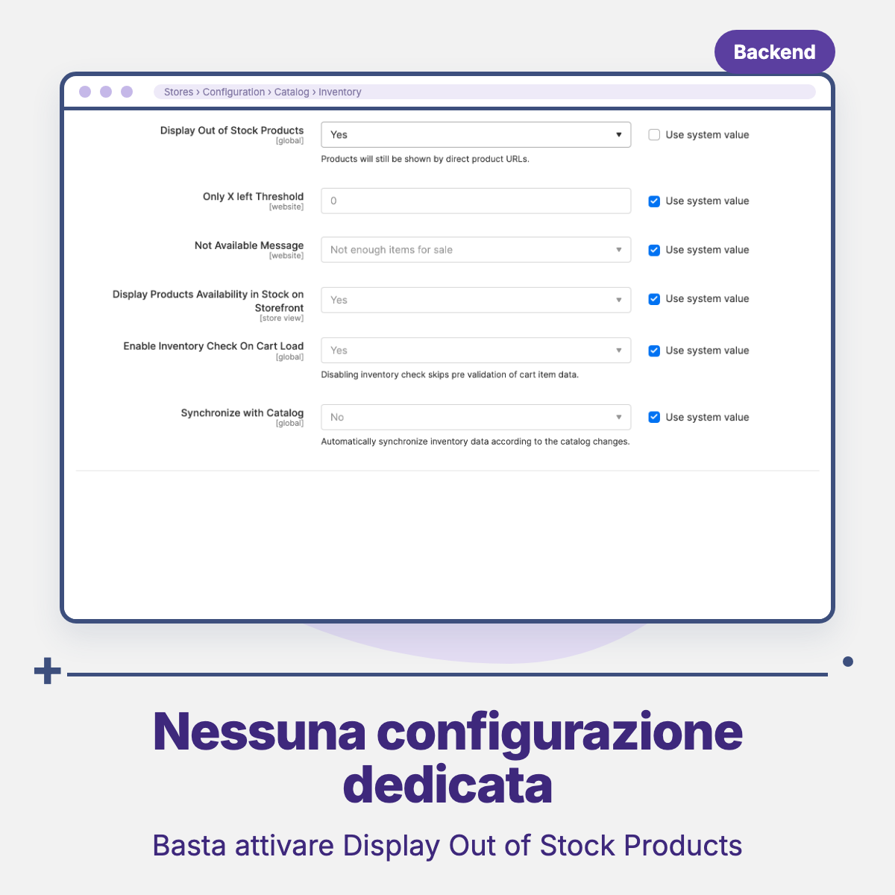

# Threecommerce_OutOfStockSorting: out of stock products last on category pages for Magento 2 / Mage-OS

Magento can show out of stock products in categories, but mixes them with the others by position, name or price. This module keeps them visible and moves them to the **end of the list**, so category pages always start with what customers can actually buy.

**Compatibility:** Magento Open Source / Adobe Commerce 2.4.4 – 2.4.9 · Mage-OS 1.x / 3.x · PHP 8.1 – 8.4 · Themes: Luma, Hyvä, Breeze
**License:** commercial · coming soon

## Features

- On category pages, **available products come first** and out of stock products follow at the end of the list.
- Inside each group the sort order chosen by the customer still applies (position, name, price, ascending or descending).
- The order holds on **every page** of the list, not only the first one, because it is applied to the product query and not to the visible blocks.
- Works with the standard search engine (OpenSearch / Elasticsearch / MySQL): the ordering is restored after the core search result applier.
- Reads the stock status Magento keeps in its own stock index, so it follows the same rules as the rest of the store.
- No templates or layouts are changed, so it works with any theme.
- Category pages only: search results keep their relevance order.

## Requirements

- Magento Open Source / Adobe Commerce 2.4.4+ or Mage-OS
- PHP 8.1 or newer
- Native modules: `Magento_Catalog`, `Magento_CatalogInventory`
- Package: `threecommerce/m2-base`
- *Stores → Configuration → Catalog → Inventory → Stock Options → Display Out of Stock Products* set to **Yes**

## Availability

This module is **not yet available to buy**. It is a commercial product and is coming soon. To be notified when it is released, or to ask for details, use the [product page](https://www.threecommerce.it/prodotti-esauriti-in-fondo-magento-2?utm_source=github&utm_medium=readme&utm_campaign=magento2-out-of-stock-sorting) or [get in touch](https://www.threecommerce.it/contatti?utm_source=github&utm_medium=readme&utm_campaign=magento2-out-of-stock-sorting).

## Configuration

The module has no settings of its own: it works as soon as **Display Out of Stock Products** is enabled. After changing that option, rebuild the indexes (`cataloginventory_stock`, `catalog_product_price`, `catalog_category_product`, `catalogsearch_fulltext`) and flush the cache. It applies to all categories of the store.

## Documentation and support

- Product page: [threecommerce.it/prodotti-esauriti-in-fondo-magento-2](https://www.threecommerce.it/prodotti-esauriti-in-fondo-magento-2?utm_source=github&utm_medium=readme&utm_campaign=magento2-out-of-stock-sorting)
- [Changelog](CHANGELOG.md)
- Support and custom development: [threecommerce.it/contatti](https://www.threecommerce.it/contatti?utm_source=github&utm_medium=readme&utm_campaign=magento2-out-of-stock-sorting)

---

*This repository is the public showcase of the module. The source code is kept in a private repository.*
